<p align="center">
  <picture>
    <source media="(prefers-color-scheme: dark)" srcset="https://raw.githubusercontent.com/junkerderprovinz/artcraft-apps/main/.github/assets/artcraft-apps-banner-dark.png">
    
  </picture>
</p>

<p align="center">
  <a href="https://github.com/junkerderprovinz/artcraft-apps/actions/workflows/build.yml"></a>&nbsp;
  <a href="https://github.com/junkerderprovinz/artcraft-apps/actions/workflows/lint.yml"></a>&nbsp;
  <a href="#2-the-apps"></a>&nbsp;
  <a href="https://github.com/junkerderprovinz?tab=packages&repo_name=artcraft-apps"></a>&nbsp;
  <a href="https://github.com/storytold"></a>&nbsp;
  <a href="https://ca.unraid.net/apps?q=craft"></a>&nbsp;
  <a href="LICENSE"></a>
</p>

<p align="center">
<b>The ArtCraft apps, in your browser.</b> Photo, video, vector, layout, CAD, audio and office work from any device. No VNC client, no local install.<br>
Each of the thirteen <a href="https://github.com/storytold">ArtCraft</a> apps gets its own container: the real Linux build runs on your server and
<a href="https://github.com/selkies-project/selkies">Selkies</a> streams it to the browser as video, so a brush stroke or a scrub through the timeline stays smooth.
</p>

<!-- download-buttons: written by scripts/gen_download_buttons.py -->
<p align="center">
  
  &nbsp;
  <a href="https://github.com/junkerderprovinz/artcraft-apps/tree/main/compose"></a>
  &nbsp;
  <a href="https://github.com/junkerderprovinz/artcraft-apps/releases/latest"></a>
</p>
<!-- /download-buttons -->

<br>

<p align="center">
A one-knight job: I build it, keep it running, work through the issues and add what people ask for, until nothing is missing. It is free, with no accounts, no telemetry, no ads and no paid tier. No asterisk anywhere. Nothing readable ever leaves your own walls. Forged on evenings and weekends, with heart and stubbornness.
</p>

<p align="center">
If it has earned a place on your server or computer, toss a coin to your knight: it helps cover the costs and keeps the project alive. It also makes this knight's heart beat a little faster. Three ways below, whichever suits you.
</p>

<!-- give-buttons: written by scripts/gen_download_buttons.py -->
<p align="center">
  <a href="https://buymeacoffee.com/junkerderprovinz"></a>
  &nbsp;
  <a href="https://www.paypal.com/donate/?hosted_button_id=76FVV52TKXTUS"></a>
  &nbsp;
  <a href="https://junkerderprovinz.github.io/junkerderprovinz/"></a>
</p>
<!-- /give-buttons -->

<br>

## Table of Contents

1. [What it does](#1-what-it-does)
2. [The apps](#2-the-apps)
3. [Getting started](#3-getting-started)
4. [How AI is used here](#4-how-ai-is-used-here)
5. [Support this project](#5-support-this-project)

<br>

## 1. What it does

- **One image per app.** PhotoCraft, FilmCraft, WordCraft and the rest each come as their own image and their own Unraid template, so you install the three you use and skip the other ten. Every image is built for amd64 and arm64.
- **The official release packages.** Each image installs the app's `.deb` from its GitHub release and checks it against the release's `SHA256SUMS.txt` first. `apps.json` pins the version of every app.
- **Selkies on Wayland.** The apps are Wayland programs, so the session runs on the Selkies base's Wayland compositor instead of an X server. The window fills the browser, and the app's own title bar is the only one.
- **Files on your array.** `/storage` (all shares by default) shows up in the open and save dialogs, which come from the desktop portal and work like on any Linux desktop. Settings and workspaces stay in `/config`.
- **Back after a close.** Quitting the app brings it straight back instead of leaving an empty desktop.
- **Sound in the browser.** SoundCraft, FilmCraft, EffectCraft and DeckCraft play through PulseAudio, which Selkies streams along with the picture.

The apps draw with Mesa's software renderer, which is plenty for documents and drawings and slower for big images and long video timelines. A passed-through Nvidia GPU takes over the video encoding of the stream (NVENC), but the apps themselves stay on the software renderer: their Vulkan path cannot present through the nested compositor yet. On the first start without a GPU, PhotoCraft asks once whether to keep using the CPU; pick **Keep Using CPU** and it remembers.

<br>

## 2. The apps

Every app has its own image, `junkerderprovinz/<app>`, mirrored at `ghcr.io/junkerderprovinz/<app>`, and its own compose file in [compose/](compose). Each card links the app's upstream repository, and the screenshot below it shows the app's start screen in a test container.

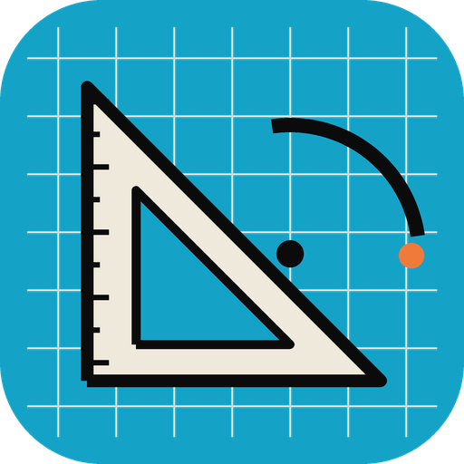
<a href="https://github.com/storytold/cadcraft"></a>
<a href="compose/cadcraft.yaml"></a>

### CADCraft
Computer-aided design and drafting: 2D drawings with layers, blocks, hatches and dimensions, and DXF and DWG files.

<br clear="all">

<details><summary>Screenshot</summary>

<p align="center">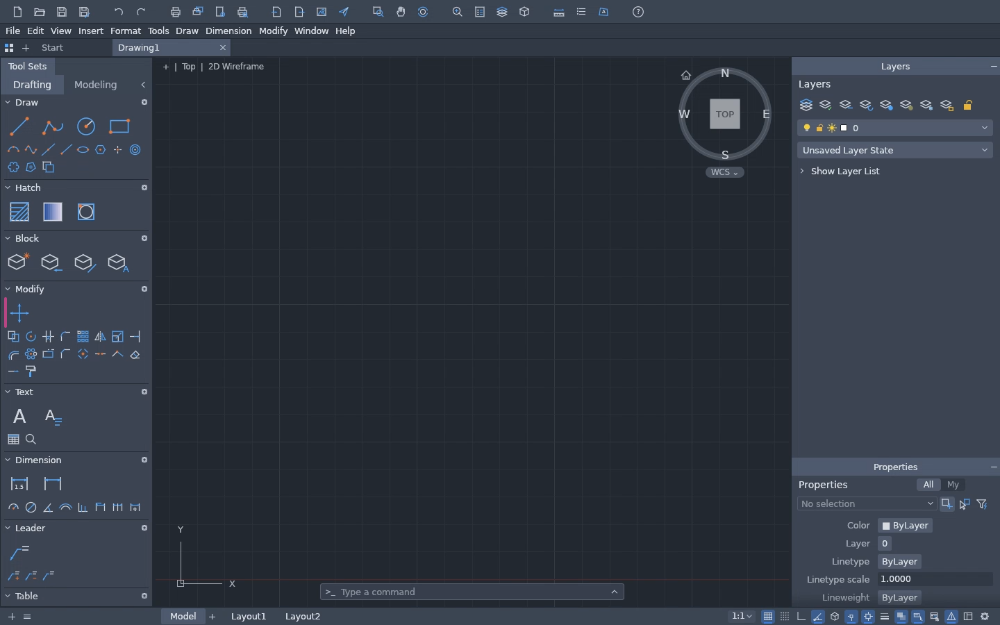</p>

</details>


<a href="https://github.com/storytold/deckcraft"></a>
<a href="compose/deckcraft.yaml"></a>

### DeckCraft
Presentations and slide shows that open and save PowerPoint decks.

<br clear="all">

<details><summary>Screenshot</summary>

<p align="center">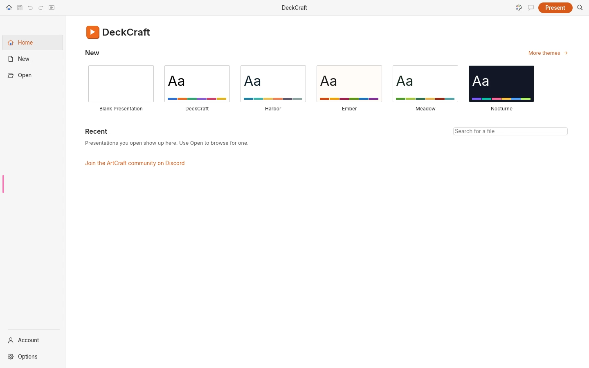</p>

</details>

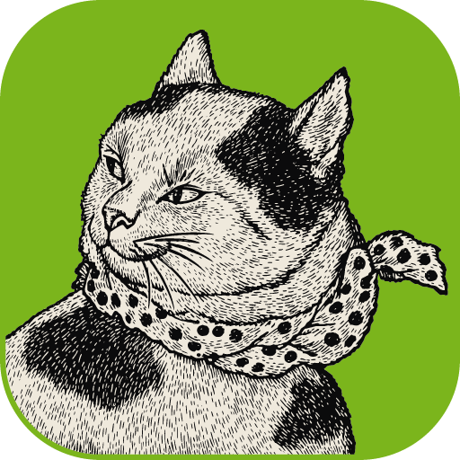
<a href="https://github.com/storytold/designcraft"></a>
<a href="compose/designcraft.yaml"></a>

### DesignCraft
Page layout and publishing for print and PDF.

<br clear="all">

<details><summary>Screenshot</summary>

<p align="center">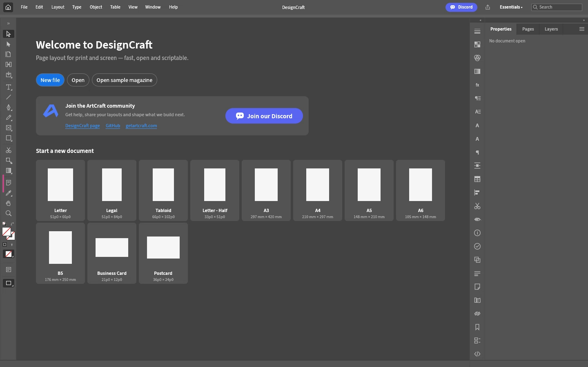</p>

</details>


<a href="https://github.com/storytold/effectcraft"></a>
<a href="compose/effectcraft.yaml"></a>

### EffectCraft
Motion graphics and compositing: compositions, keyframes and effects.

<br clear="all">

<details><summary>Screenshot</summary>

<p align="center">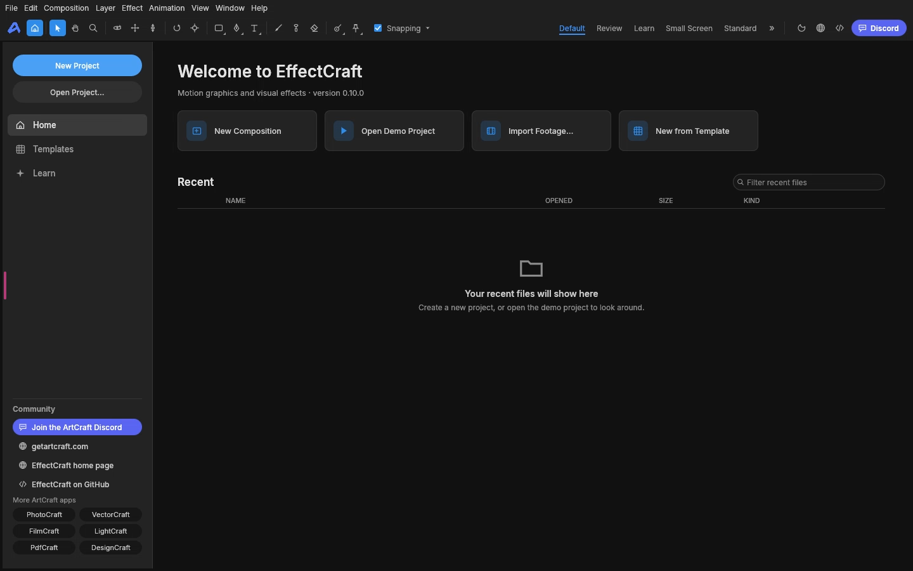</p>

</details>


<a href="https://github.com/storytold/figcraft"></a>
<a href="compose/figcraft.yaml"></a>

### FigCraft
Interface design and prototyping: frames, auto layout, components and prototypes.

<br clear="all">

<details><summary>Screenshot</summary>

<p align="center">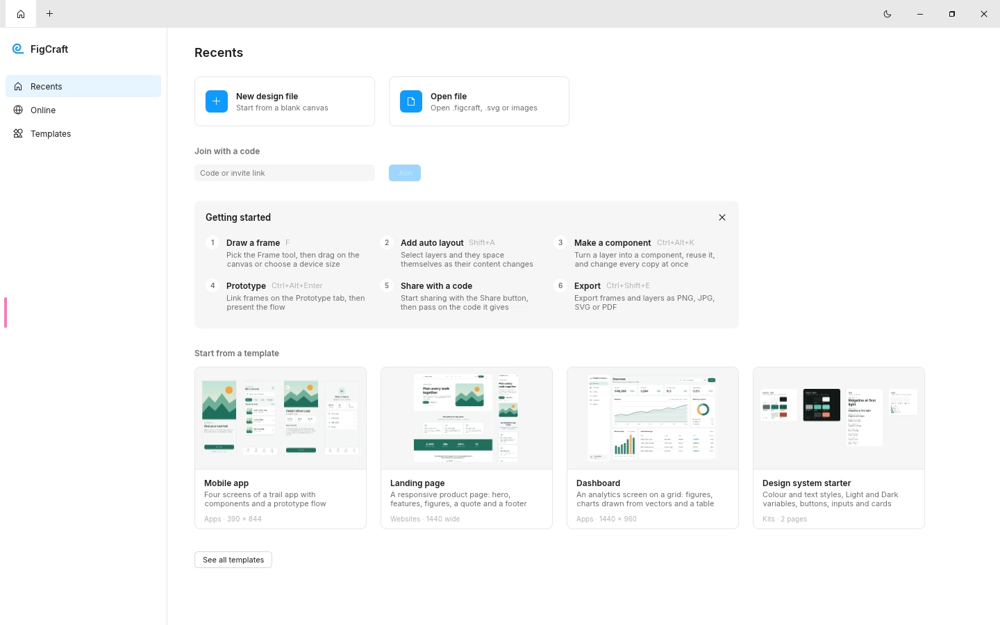</p>

</details>

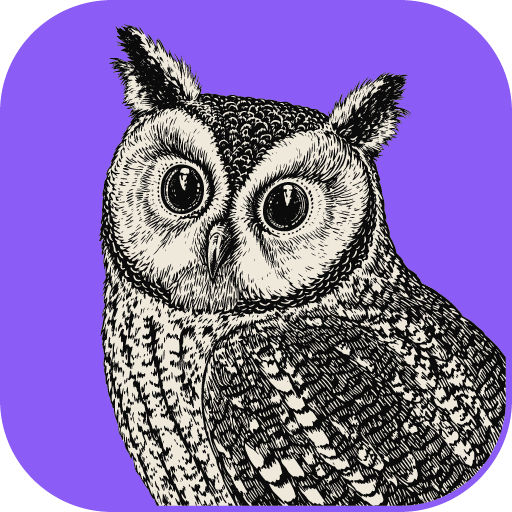
<a href="https://github.com/storytold/filmcraft"></a>
<a href="compose/filmcraft.yaml"></a>

### FilmCraft
A nonlinear video editor with a timeline, effect controls, captions and export.

<br clear="all">

<details><summary>Screenshot</summary>

<p align="center">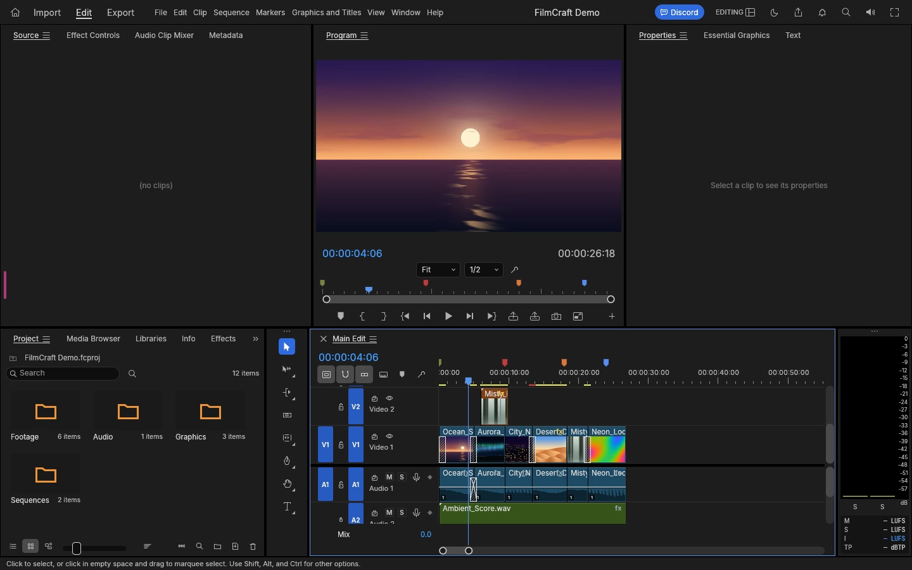</p>

</details>


<a href="https://github.com/storytold/gridcraft"></a>
<a href="compose/gridcraft.yaml"></a>

### GridCraft
A spreadsheet with formulas, charts and Excel workbooks.

<br clear="all">

<details><summary>Screenshot</summary>

<p align="center">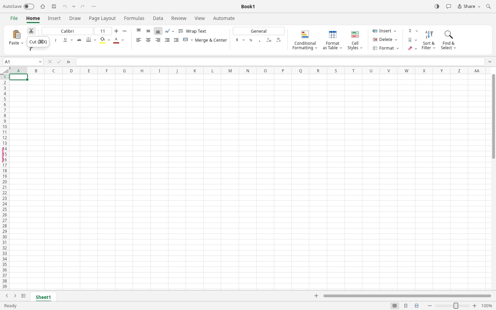</p>

</details>


<a href="https://github.com/storytold/lightcraft"></a>
<a href="compose/lightcraft.yaml"></a>

### LightCraft
A photo library and non-destructive raw developer.

<br clear="all">

<details><summary>Screenshot</summary>

<p align="center">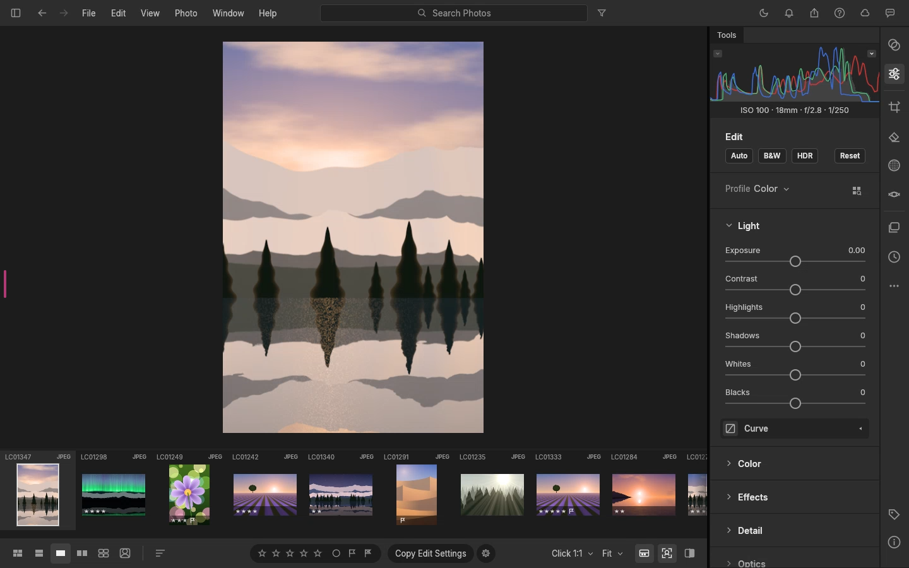</p>

</details>

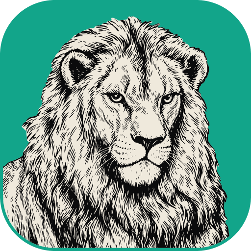
<a href="https://github.com/storytold/pdfcraft"></a>
<a href="compose/pdfcraft.yaml"></a>

### PdfCraft
A PDF reader and editor: annotate, fill and sign forms, organise pages, redact and run OCR.

<br clear="all">

<details><summary>Screenshot</summary>

<p align="center">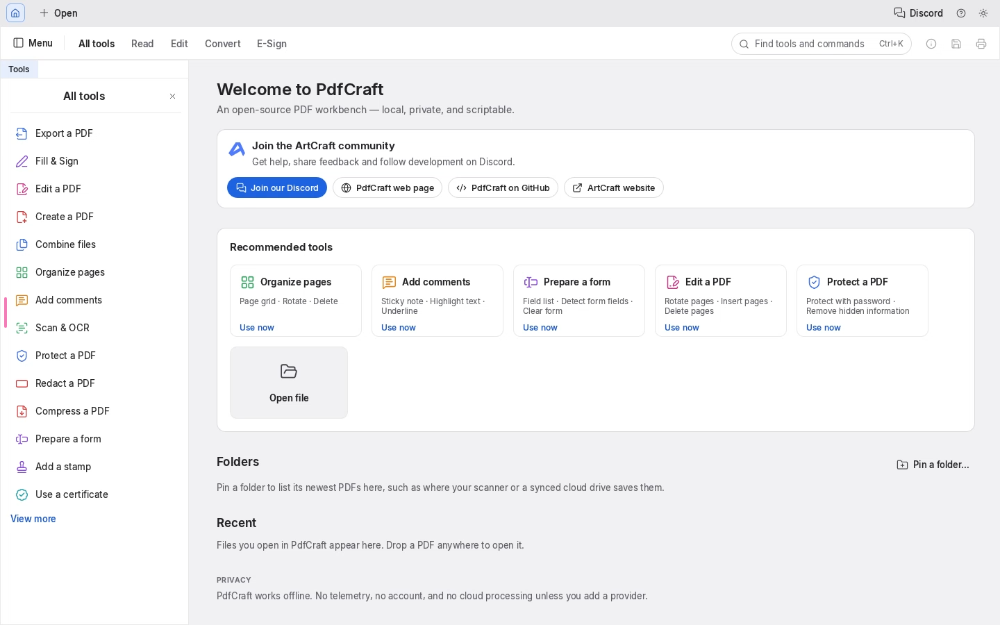</p>

</details>

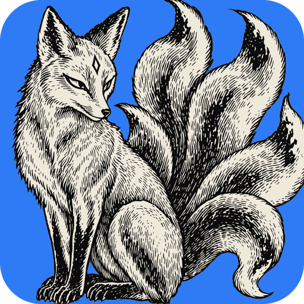
<a href="https://github.com/storytold/photocraft"></a>
<a href="compose/photocraft.yaml"></a>

### PhotoCraft
A layered photo editor that opens PSD, Krita, OpenRaster and Affinity files.

<br clear="all">

<details><summary>Screenshot</summary>

<p align="center">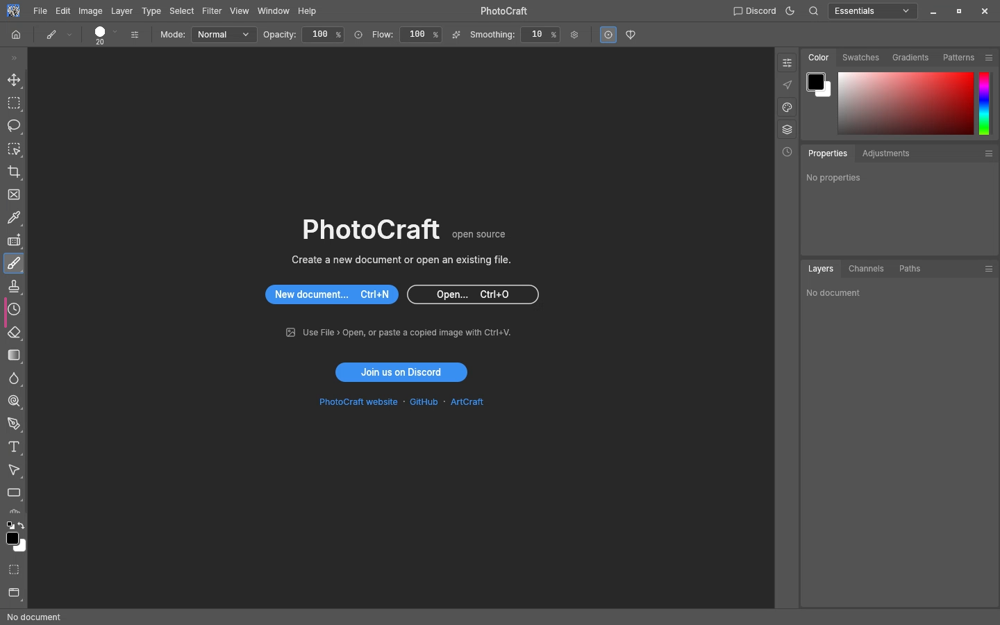</p>

</details>

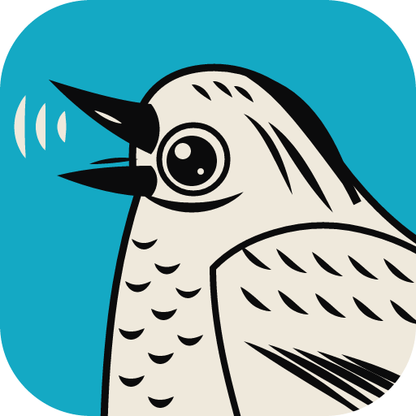
<a href="https://github.com/storytold/soundcraft"></a>
<a href="compose/soundcraft.yaml"></a>

### SoundCraft
Multitrack audio recording, editing and mixing.

<br clear="all">

<details><summary>Screenshot</summary>

<p align="center">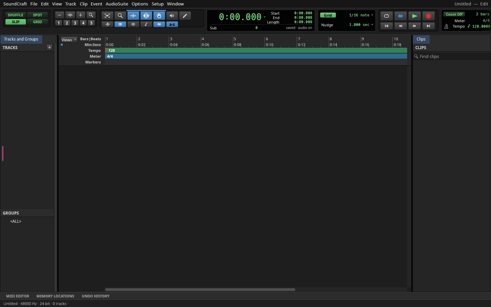</p>

</details>


<a href="https://github.com/storytold/vectorcraft"></a>
<a href="compose/vectorcraft.yaml"></a>

### VectorCraft
Vector illustration with paths, type and SVG and PDF in and out.

<br clear="all">

<details><summary>Screenshot</summary>

<p align="center">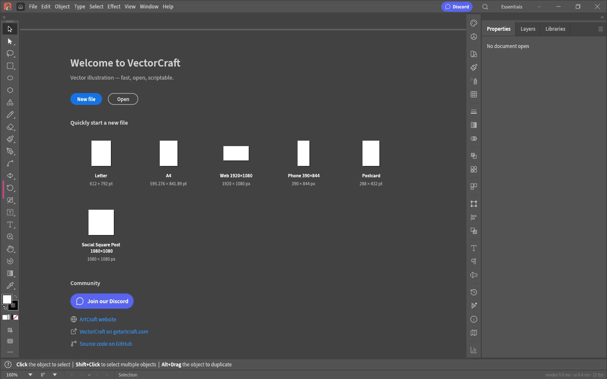</p>

</details>


<a href="https://github.com/storytold/wordcraft"></a>
<a href="compose/wordcraft.yaml"></a>

### WordCraft
A word processor that opens and saves Word documents.

<br clear="all">

<details><summary>Screenshot</summary>

<p align="center">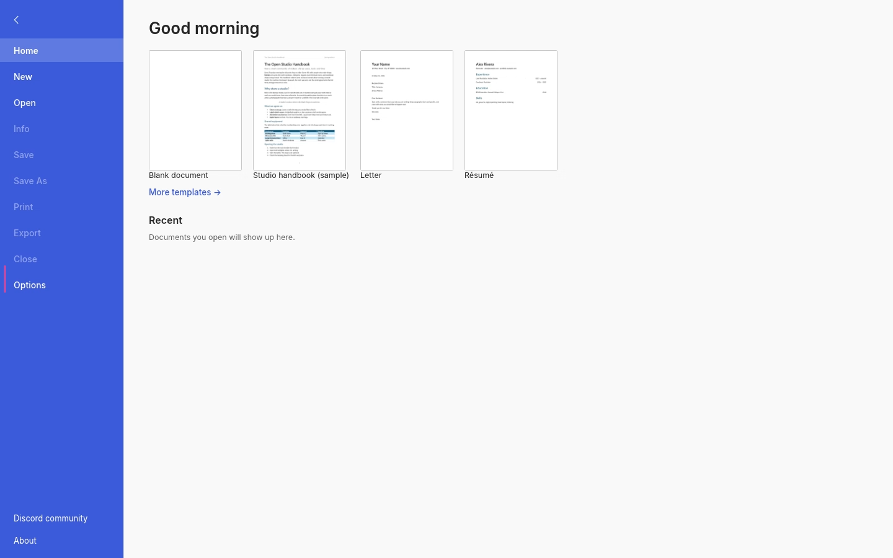</p>

</details>

<br>

## 3. Getting started

On Unraid, search Community Applications for the app you want, PhotoCraft for example. Map the folder with your files to `/storage` (the template uses `/mnt/user`, which reaches all shares), then open the WebUI on the HTTPS port, `3001` by default. Each app is its own template, so two apps on one server need two different ports.

Without Unraid:

```bash
docker run -d --name photocraft --shm-size=1gb \
  -p 3001:3001 \
  -e PUID=99 -e PGID=100 \
  -v /path/to/appdata/photocraft:/config \
  -v /path/to/your/files:/storage \
  junkerderprovinz/photocraft:latest
```

Swap `photocraft` for any app from the list above. Open `https://<server-ip>:3001/` and accept the self-signed certificate once. In the open and save dialogs, pick `/storage` from the side bar.

> [!NOTE]
> The WebUI has no login by default, for use on a trusted network. Never expose it to the internet directly: put it behind a VPN or a reverse proxy with authentication, or set `CUSTOM_USER` and `PASSWORD` to turn on the built-in login.

### Image tags

| Tag | What it is |
| --- | --- |
| `latest` | The newest release of this repository. |
| `0.9.0` | The app version, moved to the newest release that ships it. |
| `0.9.0-r1.0.0` | The app version inside one release of this repository, fixed. |
| `edge` | The tip of `main`. |

### Other Docker hosts

[compose/](compose) has one file per app for any Linux server with Docker. Put the one you want in a folder of its own, point the folders under `volumes` at your files and start it with `docker compose up -d`. The folders are created next to the file.

- **Synology:** in Container Manager, create a project from the file (DSM 7.2 or newer).
- **Proxmox:** run it in a VM or an LXC container that has Docker.

<br>

## 4. How AI is used here

One knight builds this, and AI is one of the tools I work with, the same way I work with an editor or a compiler. It helps me write code and documentation and it checks my work, and that saves me a good many evenings. It does not make the decisions, though. I read and understand everything before it ships, and if something here breaks, that is on me and not on the tool.

You do not have to take my word for it. The code is open and every release note is written by hand. The issue tracker shows how problems actually get handled, including the ones I got wrong the first time. If you find something that is not right, open an issue and I will look at it.

<br>

## 5. Support this project

Questions, bugs, ideas or feature requests? Please [open a GitHub issue](https://github.com/junkerderprovinz/artcraft-apps/issues). Bugs in an app itself belong to the ArtCraft project; the app's upstream link above leads to its tracker.

A one-knight job: I build it, keep it running, work through the issues and add what people ask for, until nothing is missing. It is free, with no accounts, no telemetry, no ads and no paid tier. No asterisk anywhere. Nothing readable ever leaves your own walls. Forged on evenings and weekends, with heart and stubbornness.

If it has earned a place on your server or computer, toss a coin to your knight: it helps cover the costs and keeps the project alive. It also makes this knight's heart beat a little faster. Three ways below, whichever suits you.

<!-- give-buttons: written by scripts/gen_download_buttons.py -->
<p align="center">
  <a href="https://buymeacoffee.com/junkerderprovinz"></a>
  &nbsp;
  <a href="https://www.paypal.com/donate/?hosted_button_id=76FVV52TKXTUS"></a>
  &nbsp;
  <a href="https://junkerderprovinz.github.io/junkerderprovinz/"></a>
</p>
<!-- /give-buttons -->

<br>

<sub>The packaging in this repository is AGPL-3.0. The ArtCraft apps are Apache-2.0 and MIT, by Storyteller and the ArtCraft contributors, and this project is not affiliated with or endorsed by them. Every bundled component and its licence is listed in <a href="NOTICE">NOTICE</a>.</sub>
